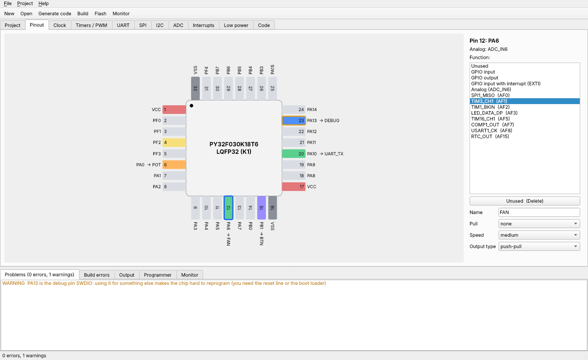

# Puya Studio

A CubeMX-style tool for three Puya Cortex-M0+ chips: **PY32F030**, **PY32F003** and **PY32F002B**.
Click pins on a drawing of the chip, set clock, timers, UART, SPI, I2C, ADC and low power, and it writes a
small C project. Build with the bundled `arm-none-eabi-gcc`, flash and watch the serial output, all from one window.



It is one file with everything inside (compiler, flash algorithms, pyOCD): nothing else to install.

> **Status: tested on a PC and in a simulator, not yet on real chips.** Every register address, bit field,
> pin and alternate function is checked against the datasheets and reference manuals, and the generated start-up code
> runs in a Cortex-M0 simulator. But no chip has run it yet. Please read [Hardware checklist](#hardware-checklist-what-to-try-first).

## Download and run

Get `puya-studio` (Linux) or `puya-studio.exe` (Windows) from the [Releases](../../releases) page, or from the latest
run on the [Actions](../../actions) page (Artifacts).

```sh
chmod +x puya-studio
./puya-studio
```

Linux: to use a debug probe without root, install the udev rule (Programmer tab > **Probe setup**, or `Help`), and for the
serial boot loader add yourself to the `dialout` group: `sudo usermod -aG dialout $USER`, then log in again.
Windows: DAPLink / CMSIS-DAP v2 probes need no driver; ST-Link V2 clones need the WinUSB driver (install it with
[Zadig](https://zadig.akeo.ie)).

## Which programmer to buy

You have an ST-Link V2 clone and a DAPLink: **both work, use the DAPLink first.**

| Option | Verdict |
|---|---|
| **CMSIS-DAP probe** (DAPLink, Raspberry Pi *Debug Probe*, or a Pico running the open `debugprobe` firmware, about 5-12 USD) | **Best choice.** pyOCD supports it best, no driver on Windows (WinUSB bulk), one udev line on Linux. Buy this if you need one. |
| ST-Link V2 clone (about 3 USD) | Works through pyOCD / libusb. Clones vary; on Windows a WinUSB driver is needed. Fine as a second probe. |
| USB-serial adapter + the chip's boot loader | **PY32F030 and PY32F003 only.** No probe needed, but no debugging, and you must pull BOOT0 high. |
| Puya's own PY-LINK | Not used here (its protocol is not documented). |

The **PY32F002B has no serial boot loader**: it can only be programmed through SWD, so it needs a probe.

## Using it

1. **File > New**: pick the chip and the **exact part number** (package pinout, flash and RAM follow from the datasheet
   ordering code), or tick *choose package and memory by hand*. Then pick an example (or an empty project). The right side
   shows the wiring for the package you picked.
2. **Pinout**: click a pin. The panel on the right lists everything that pin can do; click a function. Give the pin a
   name (`LED`) and settings. **To clear a pin**: press **Unused**, press **Delete**, or **right-click** the pin. Nothing
   pops up. Dual-bonded pads (two ports on one pin, e.g. `PA5/PB4`) are one pad with a port choice in the panel.
3. **Clock**, **Timers / PWM**, **UART**, **SPI**, **I2C**, **ADC**, **Interrupts**, **Low power**: only what the chip
   really has (for example the PY32F002B has no PLL, no DMA, one USART, TIM1 and TIM14 only).
4. The **Problems** list checks while you work: signal on two pins, clock above the chip's limit, baud-rate error,
   peripheral without its pins, interrupt line conflicts, debug / reset pin reused, stop mode with no wake-up source ...
   **Double-click a problem** to jump to the cause.
5. **Generate** writes the project. Your code between `/* USER CODE BEGIN ... */` and `/* USER CODE END ... */` is kept.
   If a section disappears (for example you removed an interrupt pin) its code moves to an `#if 0` block at the end of the file.
6. **Build** (Ctrl+B) shows ROM and RAM use; errors are clickable. **Flash** (Ctrl+U) builds and programs. **Monitor**
   (Ctrl+M) is a serial terminal.

### The generated project

```
project.pstudio   the settings (JSON)
main.c            your code (only the USER CODE sections are yours)
init.c / init.h   generated: clock, pins, peripherals, helpers (delay_ms, usart1_puts, adc_read, ...)
interrupts.c      one handler per enabled interrupt, with USER CODE sections
py32f030.h        generated: this chip's registers and bits, from the chip database
startup.c, link.ld, Makefile
```

No vendor HAL, no folders of unused files. For a pin named `LED` set as output: `LED_HIGH()`, `LED_LOW()`, `LED_TOGGLE()`,
`LED_WRITE(x)`, `LED_READ()`; inputs: `BTN_READ()`; PWM pins: `FAN_SET_DUTY(permille)`; analog pins: `POT_ADC_CH`.
Also `millis()`, `delay_ms()`, `enter_sleep()`, `enter_stop()`, `usart1_puts()`, `usart1_print_u32()`, `spi1_transfer()`,
`i2c1_write()/read()/probe()`, `adc_read(channel)`, `IWDG_KICK()`.

### Examples (17, each for every package that has the pins)

Blink, Blink with `millis()`, Button controls LED, Button interrupt, UART Hello World, UART echo (interrupt + ring buffer),
PWM fade, PWM two channels, Timer interrupt, ADC potentiometer, ADC internal sensors, I2C bus scan, SPI loop-back,
Sleep and wake up, Stop mode and wake up, Independent watchdog, Clock output (MCO).

## The chips

Facts below come from the datasheets and reference manuals (newest revision found; see `puya_studio/chips/*.json`,
section `sources` and `notes`). Your memory was right on all numbers.

| | PY32F030 | PY32F003 | PY32F002B |
|---|---|---|---|
| Core / max clock | Cortex-M0+ / **48 MHz** | Cortex-M0+ / **32 MHz** | Cortex-M0+ / **24 MHz** |
| Flash / RAM | 8-64 KB / 1-8 KB | 16-64 KB / 2-8 KB | **24 KB / 3 KB** |
| Clock sources | HSI 4/8/16/22.12/24 MHz, HSE 4-32 MHz, **PLL x2**, LSI, LSE | HSI 4..24 MHz, HSE 4-32 MHz, **no PLL**, LSI, LSE | HSI 24 MHz only, external clock input, LSI, LSE, **no PLL** |
| Timers | TIM1 (adv.), TIM3, TIM14, TIM16, TIM17, LPTIM, IWDG, WWDG, RTC | same | TIM1, TIM14, LPTIM, IWDG |
| Serial | 2 USART, 2 SPI, 1 I2C | 2 USART, **1 SPI**, 1 I2C | 1 USART, 1 SPI, 1 I2C |
| Other | 12-bit ADC (10 ch), 2 comparators, 3-ch DMA, LED driver, CRC | like F030 without LED driver | 12-bit ADC (8 ch), 2 comparators, CRC, **no DMA / RTC** |
| SWD pins | PA13 / PA14 | PA13 / PA14 | **PB6 (SWDIO) / PA2 (SWCLK)** |
| Packages in the tool | LQFP32 (2 pinouts), QFN32, SSOP24 (2), QFN20 (2), TSSOP20 (4) | TSSOP20 (6), SOP20, QFN20 | TSSOP20, SOP16, SOP14, QFN20 |

Every pinout variant (`LQFP32-K1` vs `-K2`, the six TSSOP20 pinouts of the PY32F003, ...) is its own entry, read from the
datasheet drawings. Not every ordering combination of package and memory size is actually sold.

**Things found in the documents** (all recorded in the database notes):

- PY32F030 datasheet Rev1.4 says LQFP32 K1 pin 1 is NC; **Rev2.2 says VCC**. Rev2.2 is used.
- The PY32F003 datasheet Rev1.9 has no real Port B alternate-function table (the section repeats Port A) and lists SPI2/LED
  functions copied from the PY32F030. SPI2/LED are dropped (the chip has none: RM, SVD, Rev1.2 EN). Port B function numbers
  PB0-PB4/PB8 are taken from the PY32F030 table (marked `inferred`; the function sets agree with the PY32F003 pin table).
- **The PY32F003 has no PLL** (no PLL register in its manual).
- The PY32F002B datasheet is an early revision (V0.8); ADC_IN1 is on PA3 per the manual's ADC table.
- The Puya SVD files have wrong reset values for some registers; the reference manual wins (offsets all agree).
- Not from Puya documents (`source: community`): the serial boot loader protocol (puyaisp.py by Stefan Wagner, MIT) and
  the PY32F002B EXTI code for port C (inferred).

Not done yet: the separate single-package datasheets (PY32F003 SOP8/MSOP10/DFN8/SOP16, PY32F030 DFN8) describe sub-families
with their own function sets; they are not in the database.

## Programming and safety

- **SWD (probe)**: pyOCD with Puya's flash algorithms (a trimmed copy of the official DFP 1.2.0 is inside). *Connect under
  reset* helps when the chip is not answering (for example the SWD pins were reassigned).
- **Serial boot loader** (F030/F003): BOOT0 (PF4) high at reset; adapter TX to `PA3/PA10/PA15`, RX to `PA2/PA9/PA14`; an adapter
  with DTR/RTS wired to BOOT0/NRST does the reset by itself.
- A read-protected chip is **never erased behind your back**: Flash refuses and says why. "Erase chip" asks first.
- **Option bytes** are edited in a table. Before anything is written the tool lists what changes and what could go wrong.
  Changes that can lock the chip or make it unreachable (read-out protection, reset pin as GPIO, moving the SWD pins,
  write protection, SDK area) need you to **type `LOCK`** (or `RISK`); smaller risks (boot source, watchdog from reset,
  brown-out level too high for your supply) ask a yes/no question. Generating code with a debug or reset pin reassigned also asks.

## Hardware checklist: what to try first

Nothing below has been run on a chip. In this order:

1. **PY32F030, Blink** (any probe, the DAPLink first): *Programmer > Chip info* shows a target and an option-byte line
   (`user: 0xBEAA` is the factory value). **Flash** the *Blink* example: the LED toggles once a second. If it is much too
   fast or slow, the HSI trim loading in `SystemClock_Config()` (factory words at `0x1FFF0F00..`) is wrong.
2. **PY32F030, UART: Hello World** (USB-serial adapter on `UART_TX`): *Monitor* shows `Hello from PY32F030!` and a counter every second.
   Then **PWM: fade an LED**, **ADC: potentiometer** (0..4095), **Button interrupt**, **Stop mode and wake up**.
3. **PY32F030 with the PLL** (Clock page: PLL, HSI 24 MHz): UART text still readable (baud rate follows the clock), *Clock output (MCO)* shows SYSCLK/8 = 6 MHz.
4. **PY32F003**: Blink, UART, then **Clock page: HSE** with a crystal (there is no PLL, so 32 MHz needs a 32 MHz crystal/clock).
5. **PY32F002B** (SWD only): Blink, UART Hello World. Its SWD pins are PB6/PA2: check your probe wiring.
6. **I2C: bus scan** with a real device, **SPI: loop-back** with MOSI wired to MISO. The I2C code follows the STM32F1-style registers
   that the PY32 manual shows; this was only compiled and read against the register list.
7. **Serial boot loader** (F030/F003): Programmer > *Serial boot loader* > Chip info shows boot loader ID `0x440`; then Flash.
8. **Option bytes**: with a spare chip, change only *BOR level* first and read it back; only then try the dangerous ones.

If something is wrong, the database file `puya_studio/chips/<chip>.json` is the one place to fix a register, pin or clock fact
(then run `python tools/build_db.py` or edit the JSON and the tests will tell you what else must change).

**Could not be tested here** (no hardware, or the vendor sites are blocked from the build machine): everything on real silicon;
the ST-Link / DAPLink connection itself; the serial boot loader against a real chip (only against a simulated one); the exact
flash timing register layout for the PY32F002B (not loaded, it only has the 24 MHz HSI); the `PRGTPE/PRETPE` halves of the
factory words (taken from the PY32F003 manual); Windows driver steps for ST-Link clones; the EXTI port-C code on the PY32F002B.

## Tests

`python -m pytest tests` (runs on Linux and Windows in CI):

- `test_chips.py`: register addresses, bit fields, interrupt numbers, pinouts and alternate-function tables **typed again by hand**
  from the datasheet drawings and reference manuals, compared with the database.
- `test_examples_build.py`: every example for every chip and every package, compiled with **no warnings**.
- `test_all_pin_functions.py`: every function of every pin of every chip goes through the generator and compiler.
- `test_sim.py`: the real compiled `Init_All()` runs in a Cortex-M0 simulator (Unicorn) with a register stub made from the
  database; the final pin, clock, timer, UART, ADC, EXTI and NVIC registers are compared with what the chip tables require.
  `usart_print_u32`, `adc_read`, PWM duty helpers run too.
- `test_timing.py`, `test_checks.py`, `test_codegen.py` (USER CODE survival, `#if 0` rule, header offsets checked by the compiler).
- `test_programming.py`: option-byte planning, the RM's option-write sequence against a fake FLASH peripheral, the serial
  boot loader against a simulated boot loader, the flash-algorithm pack.
- `test_gui.py`: the window offscreen: every page and every pin function on every chip and package, clicking, Delete,
  right-click, problem jumps, New dialog, build errors, programming with fakes. Any exception fails the test.

QEMU and Renode have no PY32 machine; Unicorn with a stub is used instead.

## Building from source

```sh
pip install -r requirements-dev.txt
python packaging/fetch_tools.py     # downloads and trims the compiler (checked with a real compile)
python -m puya_studio               # run from source
python -m pytest tests
python packaging/build.py           # one-file executable in dist/
```

Command line without a window: `puya-studio new myproj -c py32f003 -e blink`, `build`, `check`, `gen`, `examples`, `tools`, `selftest`.

**Releases:** run the *build* workflow by hand (Actions > build > Run workflow) and type a version such as `v0.1.0`; it builds and
tests on Linux and Windows and creates the release with both files (the tag is created by the workflow, no tag push needed).

## Layout

```
puya_studio/   chips/*.json (one database per chip)  gen_header  codegen  checks  timing  usercode  toolchain
               option_bytes  serial_isp  flasher  examples  project  ui/ (window)  data/ (flash algorithm pack)
tools/         dev tools that read the PDFs: extract_pinouts / extract_af / extract_analog / build_db / verify_regs
packaging/     fetch_tools (compiler), build (one-file executable)     tests/     .github/workflows/
```

## Credits and licences

- This program: MIT (`LICENSE`).
- Bundled: [xPack GNU Arm Embedded GCC](https://github.com/xpack-dev-tools/arm-none-eabi-gcc-xpack) 13.3.1 (GPL-3.0 with the runtime
  library exception; trimmed; source at the project), [pyOCD](https://github.com/pyocd/pyOCD) (Apache-2.0), PySide6 / Qt (LGPL-3.0),
  pyserial (BSD), libusb (LGPL-2.1), and the flash algorithms of the Puya `PY32F0xx_DFP` 1.2.0 (published by Puya; a trimmed copy,
  see `tools/make_trimmed_pack.py`).
- Register bit fields come from Puya's SVD files in that DFP; documents were read from the community mirror
  [decaday/PY32_Docs](https://github.com/decaday/PY32_Docs). The boot loader protocol comes from
  [wagiminator/MCU-Flash-Tools](https://github.com/wagiminator/MCU-Flash-Tools) `puyaisp.py` (MIT); [IOsetting/py32f0-template](https://github.com/IOsetting/py32f0-template) was used for cross-checks.
- Layout and workflow follow the author's [Padauk Studio](https://github.com/PoGo430/Padauk-tools).
